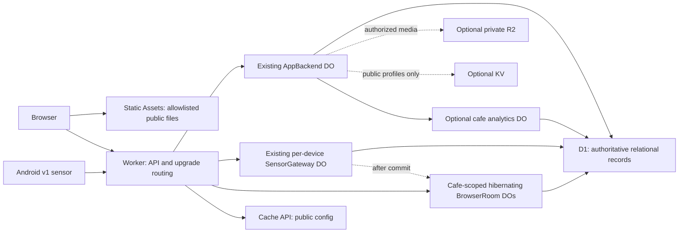

# LiveSpace Cloudflare architecture

Phase 7.2 is a local preparation, not a production deployment. The owner-provided production hostname is `https://livecafe.space`; DNS, routes and TLS were not changed or revalidated here. Historical workers.dev test endpoints in earlier documents are retained as historical evidence.

Services are not a mandatory sequential storage chain. A live update never round-trips through R2 or KV. Only services appropriate to each data type participate.

| Service | Responsibility | Consistency / authority |
| --- | --- | --- |
| Static Assets | Existing HTML, JS, CSS, artwork, security headers | Asset-first delivery; API/WS remain Worker-first |
| Worker | TLS/origin boundaries, routing, small config edge cache | No private shared cache |
| AppBackend DO | Existing HTTP API, bounded Phase 7.1 live/history caches, public profile version coordination | Single existing API coordinator; potential future throughput bottleneck |
| D1 | Accounts, sessions, tenant ownership, cafes, devices, telemetry, replay receipts, media metadata, hourly analytics summaries | Authoritative durable business state; ordered additive migrations |
| R2 (optional) | Raster bytes behind authorized existing photo URLs | Private by default; staged journal handles cross-service failures |
| KV (optional) | Versioned sanitized public profiles | Eventual, bounded TTL; never live state/auth/inventory/orders |
| SensorGateway DO | Existing authenticated Android connections, admission/rate windows | Protocol unchanged; accepted ACK follows atomic D1 success |
| BrowserRoom DO | One recoverable current projection per cafe, hibernating sockets, scoped fan-out | Derived state; snapshots recover from D1; notification is best-effort |
| AnalyticsAggregator DO | Optional durable receipt deduplication and counters | Durable acceptance before response; idempotent D1 summary flush |
| Node / SQLite | Existing local server, filesystem media, SSE, sensor gateway | Preserved native fallback; cloud bindings not required |

## Data and security boundaries

Authentication uses the existing scrypt and HttpOnly sessions; D1 session revocation and role changes remain authoritative. No competing credential table is added. Private browser attachments contain a session hash solely for indexed revalidation. Public frames never include it. Cafe rooms do not share tenant state or private subscribers. Public eligibility is rechecked on connection and publication/maintenance; management mutations notify after success.

Media objects are created only through existing authorized onboarding, not an unrestricted arbitrary-key upload endpoint. Existing owner/admin media authorization remains before byte access and conditional responses. Pending and referenced R2 objects are tracked separately; database timeouts do not trigger blind object deletion.

No Phase 11 business features are implemented: menu management, inventory, reviews, promotions, notifications and preorders remain future work. The prepared analytics event names are a bounded interface, not evidence that those features exist. There is no trained forecasting model or inferred physical seat tracking.

## Deployment preparation and approval boundaries

1. Review all existing teammate and Phase 7.1 uncommitted changes; preserve them. Run the documented local suites, load matrix, and Wrangler dry run.
2. Record current version and approved backup. Check the existing D1 ID and current migration state. Do not reseed, reset, recreate or delete data.
3. Apply ordered additive D1 migrations 0006 (if pending), 0007 (optional media pointers/journal), 0008 (hourly summary table) only after rollout authorization and daily quota reset. Index creation itself consumes budget.
4. Wrangler prepares BrowserRoom and AnalyticsAggregator SQLite class migrations and bindings. An approved deployment would create these remote DO namespaces; do not deploy merely to run a local test. Keep original SensorGateway/AppBackend tags intact.
5. R2 and KV are absent from production configuration. Creating a private Standard R2 bucket and a KV namespace requires explicit separate approval. Never enable paid plans, public R2 access or automatic image migration. Bind `MEDIA` / `PUBLIC_CACHE` only after approval; set their feature flags deliberately. Leave analytics off until Phase 11 approval.
6. Update recovery configuration with the same cumulative DO migration history and binding classes before any approved rollout. A code rollback must not drop namespaces or reverse additive D1 migrations. A recovery disables realtime/analytics/new media writes while retaining required read bindings and data. R2-only photos require retaining R2 access.
7. Smoke-test login/RBAC, owner scoping, sensor accepted/duplicate ACK, public/private room isolation, reconnect snapshots, stale/offline labels, history, and both old/new photo URLs. Verify actual account metrics over a quiet pilot period. Local timings do not prove global CPU limits or physical Android behavior.

See [media storage](MEDIA_STORAGE.md), [cache strategy](CACHE_STRATEGY.md), [realtime](REALTIME_ARCHITECTURE.md), [analytics](ANALYTICS_ARCHITECTURE.md), and [capacity](FREE_TIER_CAPACITY.md) for failure behavior, limits and rollback details.
